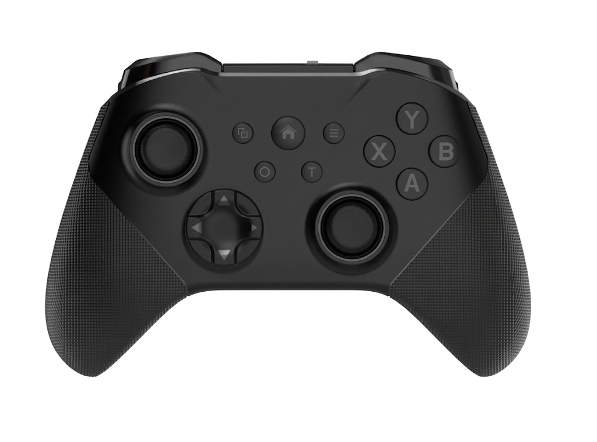

<div align="center">

# Massmore_MomoJoy

**BLE HID gamepad host library for ESP32 / ESP32-S3**
ไลบรารีสำหรับให้ ESP32 อ่านค่าจอยเกม Bluetooth ได้โดยตรง



**MOMO Joystick Controller · SKU-1001** · by [Massmore](https://massmore.shop)

`Arduino IDE (ESP32 core 3.x)` · `PlatformIO (pioarduino 55.03.x)` · `NimBLE-Arduino 2.x` · `MIT`

</div>

---

> **คู่มือการใช้งานฉบับเต็ม (ภาษาไทย) — [อ่านบนเว็บ](docs/MOMOJoystick_UserManual.md) · [PDF](docs/MOMOJoystick_UserManual.pdf) · [Word](docs/MOMOJoystick_UserManual.docx)**
> ติดตั้ง Library ทีละขั้น · จับคู่จอย · หุ่นยนต์ 2 ล้อ และ 4 ล้อ · Factory Test · แก้ปัญหา
> *Full user manual in Thai — step-by-step install, pairing, both robot boards, factory test, troubleshooting.*

## What it is / คืออะไร

`Massmore_MomoJoy` turns an ESP32 or ESP32-S3 into a **BLE HID host**, so your
board can read a Bluetooth game controller directly - no phone, no PC, no
dongle. Sticks, analog triggers, D-pad, 18 buttons and battery level arrive as
plain numbers you can use to drive motors, LEDs or anything else.

ไลบรารีนี้ทำให้บอร์ด ESP32 / ESP32-S3 **ต่อกับจอยเกมบลูทูธได้โดยตรง** ไม่ต้องผ่านมือถือหรือคอม
อ่านค่าอนาล็อกสติ๊ก ไกอนาล็อก ปุ่มกด และแบตเตอรี่ ออกมาเป็นตัวเลขพร้อมใช้ควบคุมมอเตอร์หรือ LED ได้ทันที

The HID Report Map is **parsed at runtime**, so nothing about the byte layout is
hard-coded. That is why it also works with most other BLE HID gamepads, not
only the MOMO pad.
ตัวไลบรารี **อ่านและแปล HID Report Map ของจอยตอนรันไทม์** ไม่ได้ fix ตำแหน่ง byte ไว้ จึงใช้กับจอย BLE ยี่ห้ออื่นได้ด้วย

---

## Specifications / สเปค

| Item | Spec |
| --- | --- |
| Controller link | Bluetooth Low Energy, HID over GATT (service `0x1812`) |
| Controller mode | mode switch position **`D`** = Android BLE HID |
| Pairing | Just Works, LE Secure Connections, bond stored in NVS |
| Host MCU | ESP32 (WROOM-32 and family), ESP32-S3 |
| Analog sticks | 2 x 2 axes, `-512 … 511`, radial dead zone |
| Analog triggers | L2 / R2, `0 … 1023` |
| D-pad | 8-way hat switch decoded to 4 direction bits |
| Buttons | up to 18 mapped bits (A B X Y L1 R1 L2 R2 L3 R3 SELECT START HOME M1 M2 C Z CAPTURE) |
| Battery | 0 … 100 %, read from the Battery Service (`0x180F`) |
| Report rate | typically 60 - 125 Hz, measurable via `reportRateHz()` |
| Connections | 1 controller at a time (central role only, keeps RAM low) |
| Flash / RAM | approx. 1.0 MB flash, 45 KB RAM for the ReadAll example |
| Dependency | NimBLE-Arduino 2.x - **bundled, nothing to install** |

> **Bluetooth Classic is not supported.** ESP32-S3 has BLE only, and this
> library is BLE-only on every target. A controller must be in its BLE / Android
> mode.
> จอยต้องอยู่ในโหมด BLE (สวิตช์ตำแหน่ง `D`) เท่านั้น โหมด Bluetooth Classic ใช้ไม่ได้

---

## Repository layout / โครงสร้างไฟล์

```text
.
├── ArduinoIDE/
│   ├── Massmore_MomoJoy.zip        <- import this in the Arduino IDE
│   ├── NimBLE-Arduino.zip          <- and this one (the only dependency)
│   └── libraries/Massmore_MomoJoy/ <- the library source + 10 examples
├── PlatformIO/
│   ├── platformio.ini              <- open this folder in VS Code, build, done
│   ├── src/main.cpp                <- pick an example by changing one number
│   └── lib/NimBLE-Arduino/         <- bundled, no download needed
├── firmware/                       <- Factory Test binaries + flash script
└── docs/images/
```

**One source of truth:** `PlatformIO/platformio.ini` points `lib_extra_dirs` at
`../ArduinoIDE/libraries`, so both toolchains compile the exact same files.
ซอร์สมีชุดเดียว ทั้ง Arduino IDE และ PlatformIO คอมไพล์ไฟล์เดียวกันเป๊ะ

---

## Install / การติดตั้ง

### PlatformIO (VS Code) - recommended

1. Open the **`PlatformIO/`** folder in VS Code.
2. Press **Build**. Everything else is already in the project.
3. **Upload**, then **Monitor** at `115200`.

เปิดโฟลเดอร์ `PlatformIO/` ใน VS Code แล้วกด Build ได้เลย ไม่ต้องติดตั้งไลบรารีเพิ่ม

To pick a different example, change one number at the top of `src/main.cpp`:

```cpp
#define MOMO_EXAMPLE 2   // 1..6, the list is in that file
```

### Arduino IDE

1. **Tools → Board → Boards Manager** → install **esp32 by Espressif Systems, version 3.x**.
2. **Sketch → Include Library → Add .ZIP Library…** → pick `ArduinoIDE/NimBLE-Arduino.zip`.
3. Same menu again → pick `ArduinoIDE/Massmore_MomoJoy.zip`.
4. **Tools → Board** → `ESP32S3 Dev Module` (or `ESP32 Dev Module`).
5. **Tools → USB CDC On Boot → Disabled** (ESP32-S3 only, so the log goes to the USB-serial chip).
6. **File → Examples → Massmore_MomoJoy → 01_Pairing** → Upload.

ขั้นตอน 2 และ 3 คือการ import ไฟล์ .zip เข้า Arduino IDE โดยตรง ไม่ต้องหาโหลดเพิ่ม

| Board setting | ESP32-S3 (16 MB / 8 MB PSRAM) | ESP32 (4 MB) |
| --- | --- | --- |
| Partition Scheme | `16M Flash (3MB APP/9.9MB FATFS)` | `Huge APP (3MB No OTA/1MB SPIFFS)` |
| PSRAM | `OPI PSRAM` | `Disabled` |
| USB CDC On Boot | `Disabled` | n/a |
| Upload Speed | `921600` | `921600` |

---

## Quick start / เริ่มใช้งาน

```cpp
#include <Massmore_MomoJoy.h>
using namespace massmore;

void setup() {
  Serial.begin(115200);
  MomoJoy.begin();                   // scan, pair and bond automatically
}

void loop() {
  MomoJoy.update();                  // call every loop - never blocks
  if (!MomoJoy.isConnected()) return;

  if (MomoJoy.justPressed(MOMO_BTN_A)) Serial.println("A!");

  int speed = -MomoJoy.ly();         // -512 .. 511, forward is negative
  int turbo =  MomoJoy.r2();         //    0 .. 1023
}
```

---

## Pairing / การจับคู่

1. Slide the controller mode switch to **`D`**.
2. Hold **HOME** about 3 seconds until the LED blinks fast (pairing mode).
3. Power or reset the board. It scans, bonds and reconnects on its own from then on.

เลื่อนสวิตช์ไปตำแหน่ง `D` → กด HOME ค้าง ~3 วินาทีจนไฟกะพริบถี่ → เปิด/รีเซ็ตบอร์ด
ครั้งต่อไปจะเชื่อมต่ออัตโนมัติเพราะ bond ถูกเก็บไว้ใน NVS แล้ว

Pairing gone wrong? `MomoJoy.forgetBonds()` clears every stored bond on the
ESP32 side; then clear the pairing on the controller too and repeat the steps.

---

## Value ranges / ช่วงค่าที่อ่านได้

| Accessor | Range | Note |
| --- | --- | --- |
| `lx() ly() rx() ry()` | `-512 … 511` | 0 = centre, radial dead zone applied |
| `lxf() lyf() rxf() ryf()` | `-1.0 … 1.0` | same value as float |
| `l2() r2()` | `0 … 1023` | analog triggers |
| `l2f() r2f()` | `0.0 … 1.0` | same value as float |
| `dpad()` | bit mask | `MOMO_DPAD_UP / DOWN / LEFT / RIGHT` |
| `buttons()` | bit mask | `MOMO_BTN_…` |
| `battery()` | `0 … 100` | `0xFF` when the controller does not report it |

Ranges match Bluepad32 on purpose, so porting an old sketch only means renaming
the accessors. ตั้งใจให้ช่วงค่าตรงกับ Bluepad32 ย้ายโค้ดเดิมมาได้เลย

---

## API / ฟังก์ชันที่ใช้บ่อย

| Group | Functions |
| --- | --- |
| Lifecycle | `begin(options)` `begin("name")` `end()` `update()` `isConnected()` `rescan()` `disconnect()` `forgetBonds()` |
| Pairing | `scanDevices(ms)` `foundCount()` `foundDevice(i)` `setAddressFilter()` `setNameFilter()` `connectToAddress()` |
| Buttons | `pressed(m)` `justPressed(m)` `justReleased(m)` `longPressed(m, ms)` `heldMs(m)` `anyButton()` `buttons()` |
| Axes | `lx() ly() rx() ry() l2() r2()` · float `…f()` · `mapStick(v, max)` |
| D-pad | `dpad()` `dpadUp()` `dpadDown()` `dpadLeft()` `dpadRight()` `dpadJustChanged()` |
| Info | `battery()` `rssi()` `peerName()` `peerAddress()` `reportRateHz()` `packets()` `version()` |
| Tuning | `setDeadzone()` `setTriggerThreshold()` `setProfile()` `setInvertLeftY()` `setInvertRightY()` |
| Callbacks | `onConnect()` `onDisconnect()` `onButton()` `onDpad()` `onRawReport()` |
| Debug | `printState()` `printStateChanges()` `printCsv()` `printJson()` `dumpReportMap()` `dumpDescriptorFields()` |

`MomoJoyOptions` fields: `localName` `nameFilter` `addressFilter` `autoReconnect`
`clearBondsOnBoot` `deadzone` `connectTimeoutMs` `triggerThreshold` `txPowerDbm`
`profile` `autoStart` `verbose`.

---

## Examples / ตัวอย่าง

Six examples, each one something you would actually ship.
หกตัวอย่าง เน้นที่ได้ใช้งานจริง

| # | Example | Board | What it does |
| --- | --- | --- | --- |
| 01 | `Pairing` | any | pair the joystick, show name / MAC / RSSI / battery / rate, erase bonds |
| 02 | `ReadAllSerial` | any | print every value; also the **calibration tool** (`SHOW_RAW_REPORTS 1`) and CSV / JSON output |
| 03 | `PairByAddress` | any | several joysticks in the room: list them, then lock this board onto one MAC |
| 04 | `Robot2WD_ESP32` | ESP32 | 2-wheel robot: one-stick driving, D-pad, servos, VR speed knob |
| 05 | `Robot4WD_ESP32S3` | ESP32-S3 | 4-wheel omnidirectional robot: encoders, buzzer, cruise, auto-drive |
| 06 | `FactoryTest` | any | guided production self-test — prebuilt `.bin` in [firmware/](firmware/README.md) |

### Driving, in one sentence / การบังคับ แบบสั้น ๆ

**Push the left stick where you want to go.** Forward, backward, sideways or
diagonal on the 4-wheel robot; forward and turning on the 2-wheel robot. Speed
follows how far you push, 0-100 %. The **D-pad** drives straight along that
arrow at a fixed speed. Nothing to configure.

**ดันก้านซ้ายไปทางที่อยากไป** รถ 4 ล้อไปได้ทั้งเดินหน้า ถอยหลัง สไลด์ข้าง และเฉียง
รถ 2 ล้อเดินหน้า-ถอยหลังและเลี้ยว ความเร็วแปรตามระยะที่ดัน ส่วน **ปุ่มลูกศร** วิ่งตรงตามทิศนั้น
ด้วยความเร็วคงที่ ไม่ต้องตั้งค่าอะไรเพิ่ม

On the 4-wheel robot the **right stick X** spins the robot on the spot, and it
mixes with everything above. บนรถ 4 ล้อ ก้านขวาแกน X ใช้หมุนตัว ผสมกับการเคลื่อนที่ได้เลย

### Example 04 — ESP32 robot board pins

| Function | Pins |
| --- | --- |
| M1 left motor | `IN1 27` `IN2 26` |
| M2 right motor | `IN1 16` `IN2 17` |
| Servo 1 / 2 / 3 | `19` `32` `33` |
| VR speed knob | `34` (analog in) |
| Switch | `36` |
| I2C | `SDA 21` `SCL 22` |
| Display SPI | `CLK 18` `MOSI 23` `RES 4` `DC 2` |

Extras: `R2` adds throttle on a straight, `Y` hold = turbo, `A` steps Servo 1
through 0 / 90 / 180 degrees, `L1` `R1` spin one wheel for a bench test, `B`
stops. The VR knob sets the top speed live (70 - 200 of 255), so you never have
to edit the code to make it slower for a classroom.
ปุ่มหมุน VR ใช้ตั้งความเร็วสูงสุดได้ทันที ไม่ต้องแก้โค้ด

### Example 05 — MOMO ESP32-S3 robot pins

Four motor drivers, two logic pins each (IN1 / IN2), driven sign-magnitude:
PWM on one pin, the other held low, at 20 kHz so the motors stay quiet.
ขับแบบ sign-magnitude จ่าย PWM ขาเดียว อีกขาเป็น 0 ที่ความถี่ 20 kHz มอเตอร์จึงไม่มีเสียงหวีด

| Motor | IN1 | IN2 | Encoder A / B | Position |
| --- | --- | --- | --- | --- |
| M1 | `GPIO21` | `GPIO38` | `1` / `2` | rear-right |
| M2 | `GPIO39` | `GPIO40` | `16` / `17` | front-right |
| M3 | `GPIO41` | `GPIO42` | `7` / `8` | front-left |
| M4 | `GPIO47` | `GPIO48` | `9` / `10` | rear-left |

Buzzer on `GPIO45`. Extras: `R3` hold = horn, `A` cruise control, `X`
auto-drive 1 m using the encoders, `Y` hold = turbo, `B` emergency stop,
`L1` `L2` `R1` `R2` spin one wheel each, `SELECT` / `START` print and reset the
encoder counts, `HOME` held 2 s erases the pairing.

Set `MECANUM_WHEELS` to `0` if the robot has ordinary wheels — the left stick
then only drives forward and back. ถ้าใช้ล้อธรรมดาให้ตั้ง `MECANUM_WHEELS` เป็น 0

Driving quality: mixing that normalises instead of clipping so full speed plus
full rotation keeps the right heading, a 50 Hz fixed-rate control loop, and a
fail-safe that cuts the motors when the link drops **or** the joystick goes
quiet for 400 ms.

### Making a strong motor controllable / ทำให้มอเตอร์แรง ๆ บังคับง่าย

Geared motors are strong enough that raw PWM launches the robot across the
room. Both robot examples soften that in three ways, and all three are one
`#define` each.
มอเตอร์เกียร์แรงมาก ถ้าจ่าย PWM ตรง ๆ รถจะพุ่ง ทั้งสองตัวอย่างจึงหน่วงไว้ 3 ชั้น แก้ได้ที่ `#define` เดียว

| Setting | Default | What it does |
| --- | --- | --- |
| `SPEED_NORMAL` | `110` of 255 | top speed of the stick — `Y` held unlocks `SPEED_TURBO` (220) |
| `SLEW_UP` / `SLEW_DOWN` | `6` / `24` | PWM change per 20 ms tick: **0.4 s to reach full speed, 0.1 s to stop** |
| `EXPO_AMOUNT` | `0.60` | how soft the middle of the stick feels — higher = softer |
| `MOTOR_MIN_DUTY` | `40` | the slowest duty the motor actually creeps at |
| `ROT_GAIN` / `TURN_GAIN` | `0.60` / `0.65` | rotation is twitchier than driving, so it gets less gain |

The stick is mapped continuously from `MOTOR_MIN_DUTY` up to the top speed, so
there is no dead band at the bottom and no sudden jump — the robot creeps at
the first millimetre of travel and reaches full speed only at the stop.
ก้านถูกแมปต่อเนื่องจาก `MOTOR_MIN_DUTY` ไปจนถึงความเร็วสูงสุด ไม่มีช่วงตายตอนต้นและไม่กระโดด

```text
stick     5%    10%    25%    50%    75%   100%
speed   41.4   42.8   47.7   59.2   78.7    110      (SPEED_NORMAL = 110)
```

On the 4-wheel robot the expo curve is applied to the **length** of the stick
vector, not to each axis, so a diagonal keeps its exact direction and only the
speed is softened. บนรถ 4 ล้อ ใส่ expo ที่ความยาวเวกเตอร์ ทิศเฉียงจึงตรงเป๊ะ

Example 04 needs no code edit at all: the **VR knob on GPIO34** sets the top
speed live, between `SPEED_MIN` (70) and `SPEED_MAX` (200).

> **Motor safety in every example.** A floating driver input can latch a driver
> on and spin a wheel for the whole session, so **all six examples park the
> motor pins LOW as the first thing in `setup()`** (`parkMotorPins()`) — the
> ESP32-S3 set on GPIO 21, 38-42, 47, 48, 45, or the ESP32 set on GPIO 27, 26,
> 16, 17, 19, 32, 33. Set `MOMO_BOARD` to `0` in an example if you run it on a
> plain dev board with nothing attached.
> ทุกตัวอย่างปักขามอเตอร์เป็น LOW เป็นอย่างแรกใน setup() เพื่อไม่ให้ขาลอยแล้วมอเตอร์หมุนค้าง

### Several joysticks at once / มีจอยหลายตัวพร้อมกัน

By default the library connects to the **first** BLE HID gamepad it sees — with
two pads awake that is a coin toss. Lock a board to one controller by its MAC
and it connects on its own at power-up, with nobody pressing anything.
ปกติไลบรารีจะต่อกับจอย "ตัวแรกที่เจอ" ถ้ามีหลายตัวจะสุ่มเอา ให้ล็อกด้วย MAC แทน
เปิดเครื่องแล้วต่อเองเลย ไม่ต้องกดปุ่ม

Example **03** does it in two uploads:

```cpp
// 1) leave it empty -> the board lists every pad in range
#define TARGET_ADDRESS ""

//    #  rssi   address             name
//    1   -41   03:52:01:09:61:b5   GamepadSpace-Q34U
//    2   -73   e4:17:d8:11:22:33   (no name)

// 2) paste the one you want -> this board only ever talks to that pad
#define TARGET_ADDRESS "03:52:01:09:61:b5"
```

The same thing from any sketch:

```cpp
MomoJoyOptions opt;
opt.addressFilter = "03:52:01:09:61:b5";   // exactly this controller
// opt.nameFilter = "Q34";                 // or match the advertised name
MomoJoy.begin(opt);
```

Listing without connecting, and choosing at runtime:

| Call | What it does |
| --- | --- |
| `opt.autoStart = false` | `begin()` prepares BLE but does not grab the first pad |
| `scanDevices(ms)` | blocking scan, returns how many gamepads are in range |
| `foundDevice(i)` | `.name` `.address` `.rssi` `.appearance` of each one |
| `setAddressFilter(mac)` / `setNameFilter(s)` | change the filter at runtime (the string is copied) |
| `connectToAddress(mac)` | filter + rescan in one call |

Set `AUTO_PICK_STRONGEST` to `1` in example 03 and the board takes the closest
pad by RSSI — no MAC to type, still no button to press.
ตั้ง `AUTO_PICK_STRONGEST` เป็น 1 บอร์ดจะเลือกจอยที่สัญญาณแรงสุดให้เอง ไม่ต้องใส่ MAC

---

### Unknown controller? / เจอจอยที่ปุ่มไม่ตรง

Open example **02**, set `#define SHOW_RAW_REPORTS 1` and upload. It prints the
HID report map and the raw bytes of every report, so you can see which HID
button number belongs to which physical button. Put those numbers into a
`MomoProfile` table and pass it as `opt.profile`.

```cpp
static const MomoButtonMap kMyMap[] = {
    {1, MOMO_BTN_A}, {2, MOMO_BTN_B}, {4, MOMO_BTN_X}, {5, MOMO_BTN_Y},
    // ... the numbers example 02 printed
};
static const MomoProfile kMyProfile = {"my pad", kMyMap,
    (uint8_t)(sizeof(kMyMap) / sizeof(kMyMap[0])), false, false};

MomoJoyOptions opt;
opt.profile = &kMyProfile;
MomoJoy.begin(opt);
```

---

## How it works / หลักการทำงาน

```text
scan  (filter: HID service 0x1812, or appearance = gamepad)
  └─ connect + bond  (Just Works, LE Secure Connections, stored in NVS)
       ├─ write Protocol Mode = Report      (0x2A4E <- 1)
       ├─ read  Report Map                  (0x2A4B) -> parser -> field table
       ├─ subscribe to every input report   (0x2A4D, type read from 0x2908)
       └─ notify -> FreeRTOS queue -> decode -> MomoGamepadState
```

Nothing assumes "byte 3 is the Y axis". Every bit offset comes from the
controller's own report descriptor, so axes, triggers and D-pad are correct on
any BLE HID gamepad. Only the **button numbering** differs per brand, and that
lives in one small table you can override (see example 02 above).

ไม่มีจุดไหนที่เดาว่า "byte ที่ 3 คือแกน Y" ทุก offset มาจาก report descriptor ของจอยเอง
มีแค่ **หมายเลขปุ่ม** ที่ต่างกันตามยี่ห้อ ซึ่งแก้ได้ในตารางเดียว

---

## Troubleshooting / แก้ปัญหา

| Symptom | Fix |
| --- | --- |
| Nothing on the serial monitor (ESP32-S3) | `USB CDC On Boot` must be **Disabled**, monitor at `115200` |
| Scans forever, never connects | controller not in pairing mode, or the mode switch is not on `D` |
| Connects then drops immediately | stale bond - `MomoJoy.forgetBonds()`, clear pairing on the pad, retry |
| `no HID service (0x1812)` | the controller is in a non-BLE mode; switch it to `D` |
| Buttons land on the wrong names | example 02 with `SHOW_RAW_REPORTS 1`, then build your own `MomoProfile` |
| Sticks drift at rest | raise the dead zone: `MomoJoy.setDeadzone(48)` |
| Sketch does not fit (classic ESP32) | partition scheme must be **Huge APP** |
| Upload fails / times out | lower `upload_speed` to `512000`, then `460800` |
| `ledcAttach was not declared` | you are on ESP32 core 2.x - this library needs **core 3.x** |
| `ambiguating new declaration` in the Arduino IDE | rare prototype-generator hiccup: every example already declares its own prototypes, so just re-verify once; if it persists, move the sketch's Thai comments into a separate file |

---

## License

MIT - see [LICENSE](LICENSE). NimBLE-Arduino is Apache-2.0 and is bundled
unmodified under `PlatformIO/lib/NimBLE-Arduino/`.

Made by **Massmore Biz Co., Ltd.** · [massmore.shop](https://massmore.shop)
