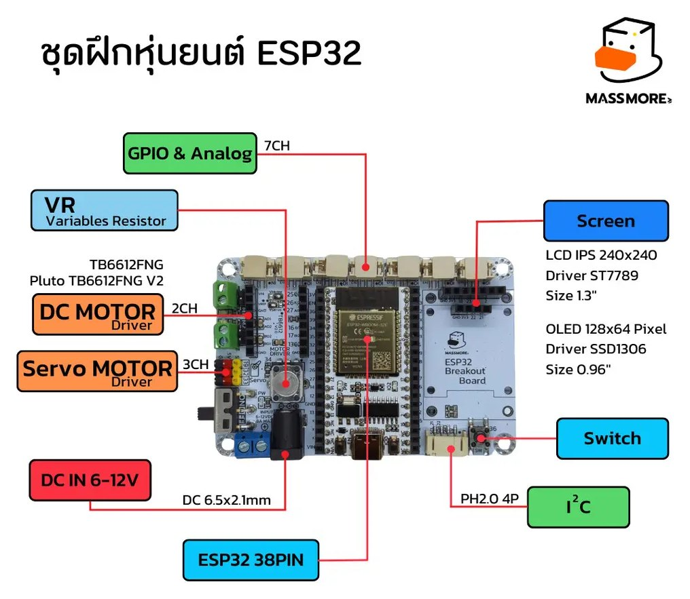
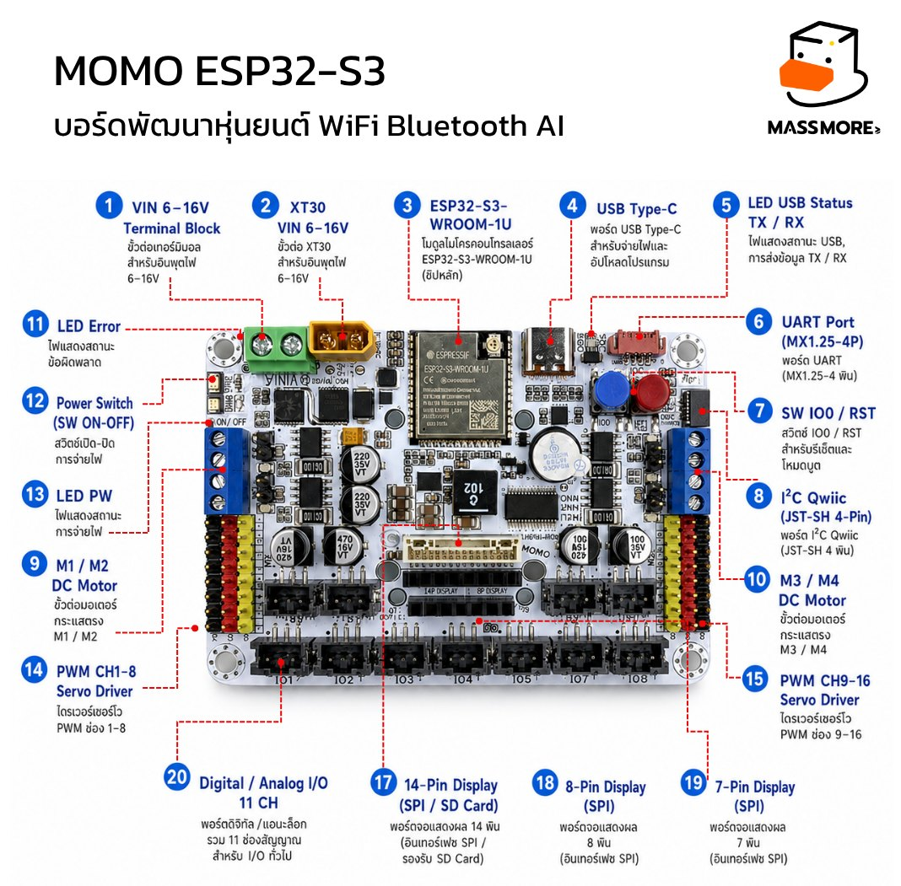
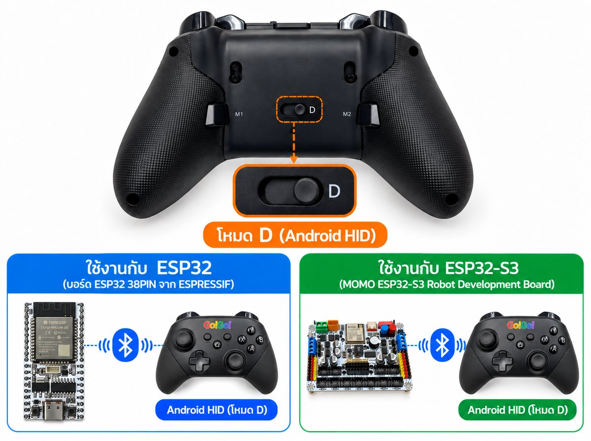
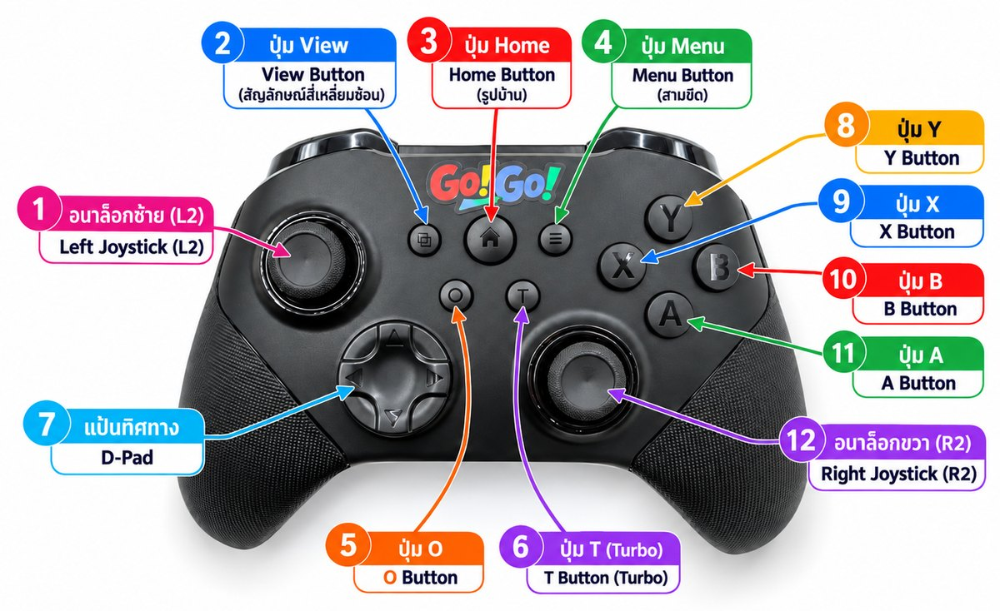
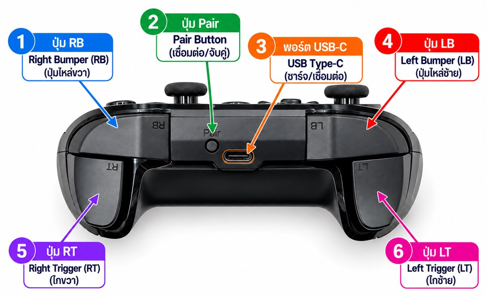
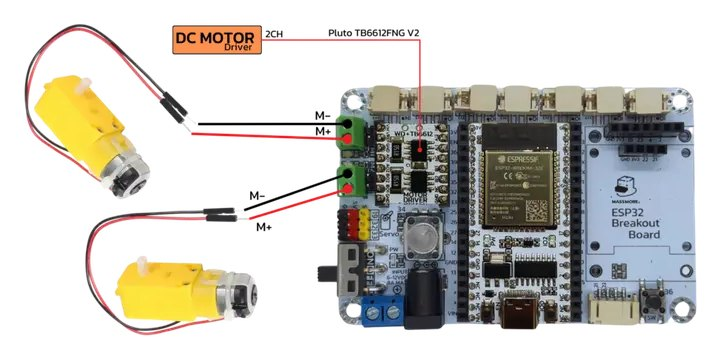
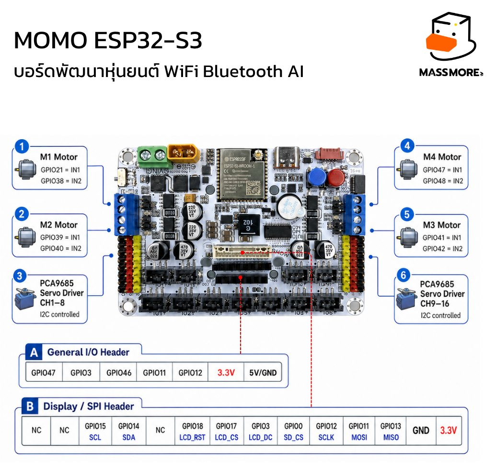
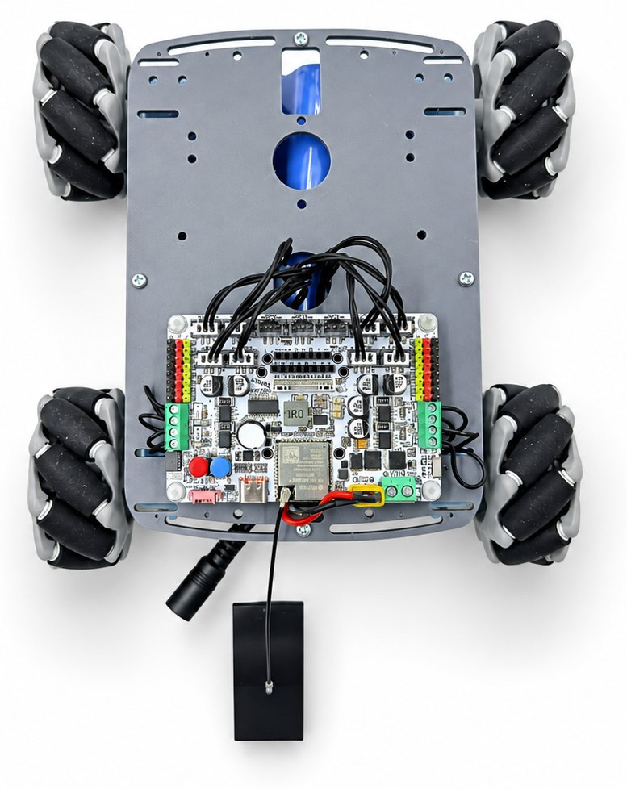

<div align="center">

# MOMO Joystick Controller · SKU-1001

**Wireless BLE joystick for ESP32 / ESP32-S3 robots: no phone, no PC, no dongle.**<br>
จอยบังคับไร้สาย BLE ต่อกับบอร์ด ESP32 / ESP32-S3 ได้โดยตรง สำหรับงานหุ่นยนต์และการเรียนการสอน


**[User Manual (PDF)](docs/MOMOJoystick_UserManual.pdf)** · **[Word / Google Docs](docs/MOMOJoystick_UserManual.docx)** · **[Firmware](firmware/README.md)** · **[Shop](https://www.massmore.shop)**

</div>

---

## Contents / สารบัญ

- [Overview](#overview--ภาพรวม)
- [Supported boards](#supported-boards--บอร์ดที่รองรับ)
- [Button map](#button-map--ผังปุ่ม)
- [Install in 5 minutes](#install--การติดตั้ง)
- [Pairing](#pairing--การจับคู่)
- [Quick start](#quick-start--เริ่มเขียนโปรแกรม)
- [Examples](#examples--โปรแกรมตัวอย่าง)
- [Robot 2WD · ESP32 Breakout (SKU-1015)](#robot-2wd--esp32-breakout-sku-1015)
- [Robot 4WD · MOMO ESP32-S3 (SKU-1020)](#robot-4wd--momo-esp32-s3-sku-1020)
- [Several joysticks in one room](#several-joysticks-in-one-room--จอยหลายตัวในห้องเดียวกัน)
- [Factory Test](#factory-test--ทดสอบจอยทีละปุ่ม)
- [API reference](#api-reference--สรุปคำสั่ง)
- [Troubleshooting](#troubleshooting--แก้ปัญหา)
- [Resources](#resources--แหล่งข้อมูล)

---

## Overview / ภาพรวม

The **`Massmore_MomoJoy`** library turns an ESP32 or ESP32-S3 into a **BLE HID host**. The board finds the joystick, pairs with it and reads every stick, trigger, button and the battery level as plain numbers, ready to drive motors or servos in a few lines.

ไลบรารี **`Massmore_MomoJoy`** ทำให้บอร์ด ESP32 / ESP32-S3 ทำหน้าที่เป็น **BLE HID Host** ค้นหา จับคู่ และอ่านค่าก้าน ไก ปุ่ม และแบตเตอรี่ของจอยออกมาเป็นตัวเลข นำไปควบคุมมอเตอร์หรือเซอร์โวได้ทันที

| Feature | Detail |
| --- | --- |
| Link | Bluetooth Low Energy, HID over GATT (service `0x1812`) |
| Joystick mode | mode switch on **`D` (Android HID)** |
| Pairing | Just Works + LE Secure Connections, bond kept in NVS: pair once, reconnects by itself |
| Analog sticks | 2 sticks × 2 axes, `-512 … 511`, adjustable radial dead zone |
| Analog triggers | L2 / R2, `0 … 1023` |
| Buttons / D-pad | up to 18 buttons, 8-way D-pad decoded to up / down / left / right |
| Battery | `0 … 100 %` from the standard Battery Service (`0x180F`) |
| Report rate | about 60–125 Hz (`reportRateHz()`) |
| Several pads in a room | lock a board to one joystick by **MAC address** |
| Other BLE gamepads | HID Report Map is **parsed at runtime**, nothing hard-coded |
| Footprint | about 590 KB flash / 37 KB RAM (Factory Test example) |
| Dependency | NimBLE-Arduino 2.x, **bundled in both toolchains** |

> [!IMPORTANT]
> BLE only. Bluetooth Classic controllers and 2.4 GHz dongle controllers are not supported, and one board talks to one joystick at a time.
> รองรับเฉพาะ BLE เท่านั้น บอร์ด 1 ใบเชื่อมต่อกับจอยได้ครั้งละ 1 ตัว

---

## Supported boards / บอร์ดที่รองรับ

<table>
<tr>
<th width="50%">ESP32 Breakout · SKU-1015</th>
<th width="50%">MOMO ESP32-S3 · SKU-1020</th>
</tr>
<tr>
<td></td>
<td></td>
</tr>
<tr>
<td>

- ESP32 38PIN module (ESP32-WROOM-32), 4 MB flash
- DC in **6–12 V**, on-board 5 V / 3 A regulator
- 2 DC motor outputs through an **external** TB6612FNG module
- 3 servo outputs, VR knob, switch, I2C, SPI screen
- Example **`04_Robot2WD_ESP32`**

</td>
<td>

- ESP32-S3-WROOM-1U-N16R8, 16 MB flash / 8 MB PSRAM
- VIN **6–16 V** via terminal block or XT30
- **4 × TB67H451AFNG** motor drivers on board, 4 encoders
- PCA9685 servo driver (16 ch), buzzer, CH343P USB-serial
- Example **`05_Robot4WD_ESP32S3`**

</td>
</tr>
</table>

<div align="center">

<br><sub>Slide the switch on the back to <b>D (Android HID)</b>, the only mode an ESP32 / ESP32-S3 can talk to.<br>เลื่อนสวิตช์ด้านหลังไปที่ตำแหน่ง D ทุกครั้งที่ใช้กับบอร์ด ESP32</sub>
</div>

---

## Button map / ผังปุ่ม

<table>
<tr>
<td></td>
<td></td>
</tr>
</table>

| Control | Read with | Range / constant |
| --- | --- | --- |
| Left stick X / Y | `lx()` `ly()` | `-512 … 511`, **pushing up gives a negative `ly()`** |
| Right stick X / Y | `rx()` `ry()` | `-512 … 511` |
| Left / right trigger (LT / RT) | `l2()` `r2()` | `0 … 1023`, plus button bits `MOMO_BTN_L2` / `MOMO_BTN_R2` |
| Left / right bumper (LB / RB) | `pressed(MOMO_BTN_L1)` / `R1` | button |
| Press left / right stick down | `pressed(MOMO_BTN_L3)` / `R3` | button |
| A B X Y | `MOMO_BTN_A` `MOMO_BTN_B` `MOMO_BTN_X` `MOMO_BTN_Y` | button |
| View / Menu / Home | `MOMO_BTN_SELECT` `MOMO_BTN_START` `MOMO_BTN_HOME` | button |
| D-pad | `dpadUp()` `dpadDown()` `dpadLeft()` `dpadRight()` | `MOMO_DPAD_*` |
| Battery | `battery()` | `0 … 100`, `0xFF` = unknown |

Float versions `lxf() … ryf()` return `-1.0 … 1.0`, and `l2f()` `r2f()` return `0.0 … 1.0`.
ใช้ `-MomoJoy.ly()` เมื่อต้องการให้ดันก้านขึ้นเป็นค่าเดินหน้า

---

## Install / การติดตั้ง

### Arduino IDE 2.x

1. **File → Preferences → Additional boards manager URLs**
   `https://espressif.github.io/arduino-esp32/package_esp32_index.json`
2. **Tools → Board → Boards Manager** → install **esp32 by Espressif Systems 3.x.x** (core 2.x will not compile).
3. Download this repository (**Code → Download ZIP**) and import **in this order**:
   **Sketch → Include Library → Add .ZIP Library** → `ArduinoIDE/NimBLE-Arduino.zip`, then `ArduinoIDE/Massmore_MomoJoy.zip`.
4. Restart the IDE. **File → Examples → Massmore_MomoJoy** now lists 6 examples.
5. Set **Tools** for your board:

| Tools menu | MOMO ESP32-S3 (SKU-1020) | ESP32 Breakout (SKU-1015) |
| --- | --- | --- |
| Board | `ESP32S3 Dev Module` | `ESP32 Dev Module` |
| USB CDC On Boot | **`Disabled`** (log goes through CH343P) | n/a |
| Flash Size | `16MB (128Mb)` | `4MB (32Mb)` |
| Partition Scheme | `16M Flash (3MB APP/9.9MB FATFS)` | **`Huge APP (3MB No OTA/1MB SPIFFS)`** |
| PSRAM | `OPI PSRAM` | `Disabled` |
| Upload Speed | `921600` (drop to `460800` if unstable) | `921600` |

> [!TIP]
> Updating from an older version? Delete the `MomoJoy` and `Massmore_MomoJoy` folders in `Documents/Arduino/libraries/` first, then import again.
> หากเคยติดตั้งเวอร์ชันเก่า ให้ลบโฟลเดอร์เดิมก่อน แล้วจึงนำเข้าไฟล์ .zip ใหม่

USB driver: the MOMO ESP32-S3 uses a **CH343P** (built into macOS 11+ and Linux, auto-installed on Windows 10/11, or from [wch-ic.com](https://www.wch-ic.com/products/CH343.html)). The ESP32 38PIN module uses CP2102 or CH340 depending on the module.

### PlatformIO (VS Code)

Open the **`PlatformIO/`** folder and build. NimBLE is already in `lib/`, so there is nothing else to install. Choose an example with one number in `src/main.cpp`:

```cpp
#define MOMO_EXAMPLE 1   // 1-6
```

| Environment | Board |
| --- | --- |
| `esp32s3` | MOMO ESP32-S3 (SKU-1020) |
| `esp32` | ESP32 Breakout (SKU-1015) |
| `factorytest_esp32s3` / `factorytest_esp32` | Factory Test firmware |

```bash
cd PlatformIO
pio run -e esp32s3 -t upload -t monitor
```

---

## Pairing / การจับคู่

1. Upload **`01_Pairing`**, open the Serial Monitor at **115200**.
2. Slide the joystick switch to **`D`**.
3. Hold **HOME** for about **3 s** until the LED **blinks fast**.
4. Press **RST** on the board. It connects, bonds and prints the name, MAC, RSSI and battery.

From then on the board reconnects on its own at every power-up. Hold **SELECT + START for 1.5 s** to erase the pairing.

เลื่อนสวิตช์ไปที่ D → กด HOME ค้างประมาณ 3 วินาทีจนไฟกะพริบถี่ → กด RST ที่บอร์ด ครั้งต่อไปบอร์ดจะเชื่อมต่อให้อัตโนมัติ

---

## Quick start / เริ่มเขียนโปรแกรม

```cpp
#include <Massmore_MomoJoy.h>
using namespace massmore;

void setup() {
  Serial.begin(115200);
  MomoJoy.begin();                 // scan, pair, reconnect automatically
}

void loop() {
  MomoJoy.update();                // call every loop, never blocks
  if (!MomoJoy.isConnected()) return;

  if (MomoJoy.justPressed(MOMO_BTN_A)) Serial.println("A");

  int speed = -MomoJoy.ly();       // -512..511, push up = forward
  int brake =  MomoJoy.l2();       //    0..1023
}
```

> [!WARNING]
> On the robot boards, park the motor pins LOW as the very first line of `setup()`. A floating driver input can spin a wheel at boot. Every example already does this with `parkMotorPins()`.
> บนบอร์ดหุ่นยนต์ ต้องกำหนดขามอเตอร์เป็น LOW เป็นคำสั่งแรกใน `setup()` ทุกตัวอย่างทำไว้ให้แล้ว

---

## Examples / โปรแกรมตัวอย่าง

| # | Example | Board | What it does |
| --- | --- | --- | --- |
| 01 | `01_Pairing` | both | pair, show name / MAC / RSSI / battery / report rate, erase bonds |
| 02 | `02_ReadAllSerial` | both | print every value when it changes; CSV / JSON output; calibration with `SHOW_RAW_REPORTS 1` |
| 03 | `03_PairByAddress` | both | list every joystick in range, then lock this board to one MAC |
| 04 | `04_Robot2WD_ESP32` | ESP32 (SKU-1015) | 2-wheel robot: one-stick driving, D-pad, servo, VR speed knob |
| 05 | `05_Robot4WD_ESP32S3` | ESP32-S3 (SKU-1020) | 4-wheel mecanum robot: encoders, buzzer, cruise, auto-drive 1 m |
| 06 | `06_FactoryTest` | both | guided 18-step joystick test with a PASS / FAIL report |

---

## Robot 2WD · ESP32 Breakout (SKU-1015)



| Function | GPIO |
| --- | --- |
| M1 left motor IN1 / IN2 | `27` / `26` |
| M2 right motor IN1 / IN2 | `16` / `17` |
| Servo 1 / 2 / 3 | `19` / `32` / `33` |
| VR speed knob | `34` |
| Switch | `36` |
| I2C SDA / SCL | `21` / `22` |
| SPI screen CLK / MOSI / RES / DC | `18` / `23` / `4` / `2` |

<br clear="right">

| Control | Action |
| --- | --- |
| Left stick | drive and turn, speed follows how far you push |
| D-pad | straight along the arrow at a fixed speed |
| R2 | extra throttle on top of the stick |
| Y (hold) | turbo |
| A | Servo 1 → 0° / 90° / 180° |
| L1 / R1 (hold) | spin the left / right wheel (bench test) |
| B | emergency stop |
| HOME (hold 2 s) | erase the BLE pairing |
| VR knob | top speed 70–200 of 255, live, no code edit |

> [!NOTE]
> SKU-1015 has **no motor driver on the board**. Fit a TB6612FNG (or equivalent) module before connecting motors.
> บอร์ด SKU-1015 ต้องติดตั้งโมดูลขับมอเตอร์ภายนอกก่อนต่อมอเตอร์

---

## Robot 4WD · MOMO ESP32-S3 (SKU-1020)

<table>
<tr>
<td width="58%"></td>
<td width="42%"></td>
</tr>
</table>

| Motor | IN1 | IN2 | Encoder A / B | Wheel |
| --- | --- | --- | --- | --- |
| M1 | `21` | `38` | `1` / `2` | rear-right |
| M2 | `39` | `40` | `16` / `17` | front-right |
| M3 | `41` | `42` | `7` / `8` | front-left |
| M4 | `47` | `48` | `9` / `10` | rear-left |
| Buzzer | `45` | | | |

| Control | Action |
| --- | --- |
| Left stick | forward, back, sideways and diagonal in one stick |
| Right stick X | spin on the spot (mixes with the left stick) |
| D-pad | straight along the arrow at a fixed speed |
| Y (hold) | turbo |
| A | cruise control on / off |
| X | auto-drive 1 m forward using the encoders |
| B | emergency stop, cancels cruise and auto-drive |
| R3 (hold) | horn |
| L1 / L2 / R1 / R2 (hold) | spin front-left / rear-left / front-right / rear-right wheel |
| SELECT / START | print / reset encoder counts |
| HOME (hold 2 s) | erase the BLE pairing |

> [!WARNING]
> Turn the **Power switch** on. With it off the board runs from USB only, the code works, but the motors do not move.
> ต้องเปิดสวิตช์ Power บนบอร์ด มิฉะนั้นมอเตอร์จะไม่หมุน

Ordinary wheels instead of mecanum: set `#define MECANUM_WHEELS 0`.

**Tuning** (both robot examples, one `#define` each):

| Setting | Default | Effect |
| --- | --- | --- |
| `SPEED_NORMAL` | `110` of 255 (SKU-1020) | stick top speed; on SKU-1015 the VR knob sets it |
| `SPEED_TURBO` | `220` / `255` | speed while Y is held |
| `SLEW_UP` / `SLEW_DOWN` | `6` / `24` | ramp per 20 ms: about 0.4 s to full speed, 0.1 s to stop |
| `EXPO_AMOUNT` | `0.60` | softer middle of the stick when higher |
| `MOTOR_MIN_DUTY` | `40` | raise to 50–60 if the robot hums but does not creep |
| `ROT_GAIN` / `TURN_GAIN` | `0.60` / `0.65` | rotation / turning sensitivity |

The motors stop the instant the link drops **or** no report arrives for 400 ms.

---

## Several joysticks in one room / จอยหลายตัวในห้องเดียวกัน

By default the board takes the **first** joystick it finds. In a classroom, lock each board to one MAC with example **03**:

```cpp
// 1) leave empty, upload: the board lists every joystick in range
#define TARGET_ADDRESS ""
//    #  rssi   address             name
//    1   -41   aa:bb:cc:dd:ee:01   <joystick 1>
//    2   -73   aa:bb:cc:dd:ee:02   <joystick 2>

// 2) paste the one you want, upload again: it connects on its own at power-up
#define TARGET_ADDRESS "aa:bb:cc:dd:ee:01"
```

The same in any sketch: `opt.addressFilter = "aa:bb:cc:dd:ee:01";` before `MomoJoy.begin(opt)`. `AUTO_PICK_STRONGEST 1` picks the closest joystick by RSSI.

ห้องเรียนที่มีจอยหลายตัว ให้ล็อกบอร์ดแต่ละใบกับจอยด้วย MAC Address และติดป้ายหมายเลขจอยกับบอร์ดให้ตรงกัน

---

## Factory Test / ทดสอบจอยทีละปุ่ม

`06_FactoryTest` walks the operator through 18 steps (A B X Y, L1 R1, L2 R2 full pull, L3 R3, D-pad × 4, both sticks around the edge, SELECT, START) and ends with a report. Lines starting with `#TEST` `#RESULT` `#VERDICT` are machine-readable for the web monitor. Type `s` + Enter to skip a step, `r` + Enter to re-run, press RST for the next joystick.

A prebuilt image for the ESP32-S3 is in [`firmware/`](firmware/README.md). Flash **`MomoJoy_FactoryTest_esp32s3_merged.bin` at `0x0`**:

```bash
esptool.py --chip esp32s3 --port <PORT> --baud 921600 \
           write_flash -z 0x0 MomoJoy_FactoryTest_esp32s3_merged.bin
```

---

## API reference / สรุปคำสั่ง

| Group | Functions |
| --- | --- |
| Lifecycle | `begin(opt)` `update()` `isConnected()` `isScanning()` `rescan()` `disconnect()` `forgetBonds()` `end()` |
| Choose a pad | `scanDevices(ms)` `foundCount()` `foundDevice(i)` `setAddressFilter()` `setNameFilter()` `connectToAddress()` |
| Buttons | `pressed()` `justPressed()` `justReleased()` `longPressed(m, ms)` `heldMs()` `anyButton()` `buttons()` |
| Axes | `lx() ly() rx() ry() l2() r2()` · `lxf() … r2f()` · `mapStick(v, max)` |
| D-pad | `dpad()` `dpadUp()` `dpadDown()` `dpadLeft()` `dpadRight()` `dpadJustChanged()` |
| Link info | `battery()` `rssi()` `peerName()` `peerAddress()` `packets()` `reportRateHz()` `msSinceReport()` `version()` |
| Tuning | `setDeadzone()` `setTriggerThreshold()` `setProfile()` `setInvertLeftY()` `setInvertRightY()` |
| Callbacks | `onConnect()` `onDisconnect()` `onButton()` `onDpad()` `onRawReport()` |
| Debug | `printState()` `printStateChanges()` `printCsv()` `printJson()` `dumpReportMap()` `dumpDescriptorFields()` |

`MomoJoyOptions`: `localName` `nameFilter` `addressFilter` `autoReconnect` `clearBondsOnBoot` `deadzone` (24) `connectTimeoutMs` (10000) `triggerThreshold` (64) `txPowerDbm` (9) `profile` `autoStart` `verbose`.

Using a different BLE gamepad whose buttons land on the wrong names? Run `02_ReadAllSerial` with `SHOW_RAW_REPORTS 1`, note the HID button numbers and pass your own `MomoProfile` as `opt.profile` (see manual section 8.4).

---

## Troubleshooting / แก้ปัญหา

| Symptom | Fix |
| --- | --- |
| No port in **Tools → Port** | install the USB driver, use a data USB cable (not charge-only) |
| `'ledcAttach' was not declared` | ESP32 core 2.x installed; switch to **3.x.x** |
| `Sketch too big` (ESP32) | Partition Scheme → **Huge APP** |
| `NimBLEDevice.h: No such file` | import `NimBLE-Arduino.zip` too |
| Serial Monitor empty (ESP32-S3) | **USB CDC On Boot = Disabled**, 115200 baud |
| `Failed to connect` on upload | hold BOOT, tap RST, release BOOT, upload again |
| Never finds the joystick | switch on **D**, hold HOME ~3 s until the LED blinks fast |
| Connects then drops / `encryption failed` | erase bonds (SELECT + START 1.5 s or `forgetBonds()`) and pair again |
| Motor spins at boot | call `parkMotorPins()` first in `setup()` |
| Motors do not move (SKU-1020) | turn the board Power switch on |
| Stick drifts at rest | `MomoJoy.setDeadzone(48)` |
| Robot drives backwards when pushing up | use `-MomoJoy.ly()` or swap the motor wires |

More cases in chapter 8 of the [manual](docs/MOMOJoystick_UserManual.pdf).

---

## Resources / แหล่งข้อมูล

| | |
| --- | --- |
| User manual (Thai) | [PDF](docs/MOMOJoystick_UserManual.pdf) · [Word / Google Docs](docs/MOMOJoystick_UserManual.docx) · [Markdown](docs/MOMOJoystick_UserManual.md) |
| MOMO ESP32-S3 (SKU-1020) | [GitHub](https://github.com/Massmore/SKU-1020_MOMO) · [Shop](https://www.massmore.shop/products/743deb7c-556d-41b7-b42a-1e9d6df55bca) |
| ESP32 Breakout (SKU-1015) | [GitHub](https://github.com/Massmore/Massmore_ESP32Breakout_SKU-1015) · [Shop](https://www.massmore.shop/products/1cbd7c12-166a-4cbb-bbc6-3d7fdce0775c) |
| NimBLE-Arduino | [h2zero/NimBLE-Arduino](https://github.com/h2zero/NimBLE-Arduino) |
| ESP32 Arduino core | [espressif/arduino-esp32](https://github.com/espressif/arduino-esp32) |
| Bluetooth HID over GATT | [HOGP 1.0](https://www.bluetooth.com/specifications/specs/hid-over-gatt-profile-1-0/) |

```text
.
├── ArduinoIDE/          Massmore_MomoJoy.zip + NimBLE-Arduino.zip (import both) + library source
├── PlatformIO/          open in VS Code and build, NimBLE bundled in lib/
├── firmware/            Factory Test .bin + flash script
└── docs/                user manual (PDF / DOCX / MD) + images
```

## License

MIT, see [LICENSE](LICENSE). NimBLE-Arduino (Apache-2.0) is bundled unmodified.

<div align="center">

Made by **Massmore Biz Co., Ltd.** · [massmore.shop](https://www.massmore.shop)

</div>
